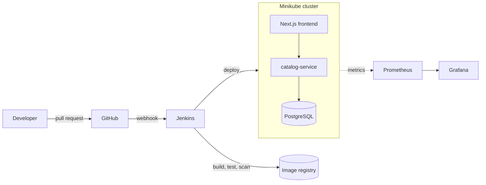

# 🛒 CartForge

> An e-commerce platform built to practice **real-world DevOps**: microservices, CI/CD, Kubernetes and observability, all running locally.

## About

CartForge is intentionally small on features and serious on engineering. The goal is not the shop itself, but everything around it: how code travels from a commit to a running, monitored deployment, following the practices used in production teams.

## Architecture (target)

## Tech stack

| Layer | Technology |
|---|---|
| Frontend | Next.js (TypeScript) |
| Backend | Java 21, Spring Boot 3.5, Spring Data JPA |
| Database | PostgreSQL + Flyway migrations |
| Containers | Docker, multi-stage builds |
| CI/CD | Jenkins (pipeline as code) |
| Orchestration | Kubernetes (Minikube), Helm |
| Observability | Prometheus, Grafana, Spring Actuator / Micrometer |
| Security | Trivy, SonarQube, OWASP Dependency-Check |

## Repositories

- **cartforge-app**: application code (this repo)
- **cartforge-gitops**: Helm charts and Kubernetes manifests

## Engineering principles

- Trunk-based development with protected `main` and pull requests only
- Conventional Commits and SemVer releases
- 12-factor configuration: env vars, no secrets in Git
- Build once, promote the same image through dev → staging → prod
- Shift-left security: scans run in the pipeline, not after release
- Decisions documented as ADRs in [`docs/adr`](docs/adr)

## Roadmap

- [x] Phase 0: repository foundations
- [x] Phase 1: catalog-service + Next.js frontend (MVP)
- [ ] Phase 2: Dockerfiles and docker-compose
- [ ] Phase 3: Jenkins CI pipeline
- [ ] Phase 4: Kubernetes deployment with Helm
- [ ] Phase 5: CD with dev / staging / prod environments
- [ ] Phase 6: Prometheus and Grafana monitoring
- [ ] Phase 7: order-service, auth-service, API gateway, autoscaling
- [ ] Phase 8: hardening (NetworkPolicies, RBAC, backups)

## Getting started

Setup instructions will be added as each phase lands. Prerequisites: Docker Desktop, JDK 21, Node.js LTS, kubectl, Minikube, Helm.

## License

MIT