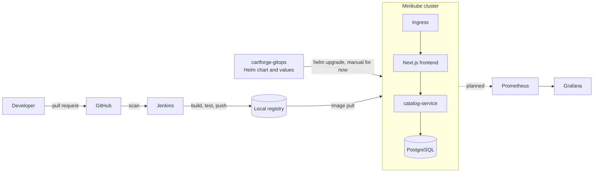
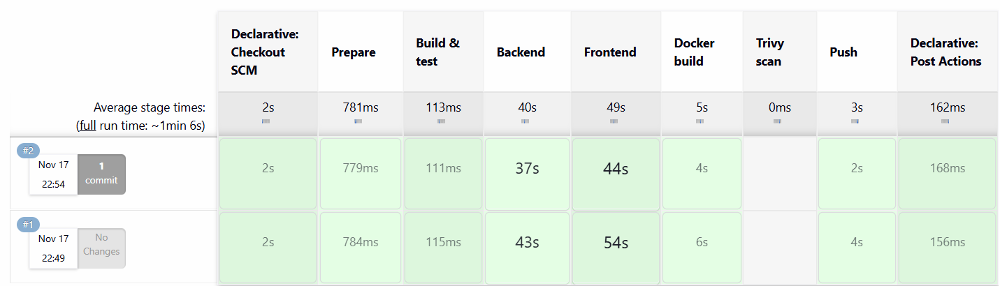
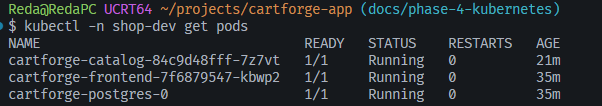
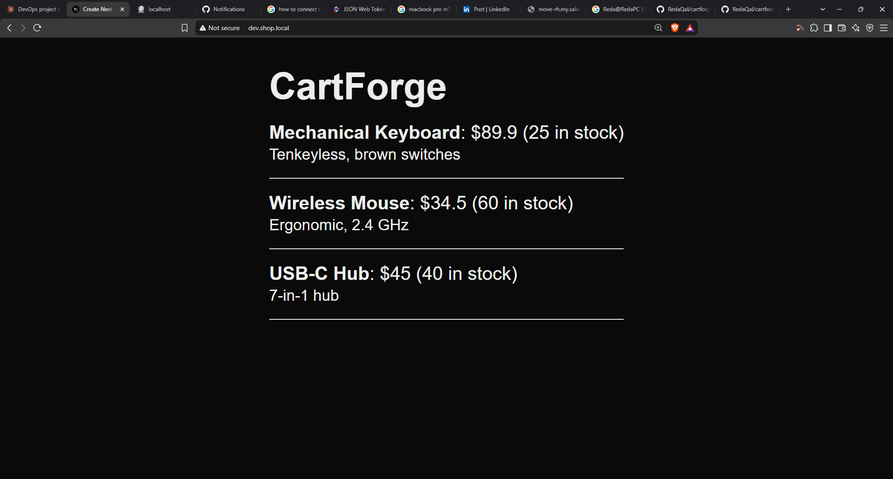

# 🛒 CartForge

## Why this project

I built CartForge to learn how software is actually delivered in production teams, not just how to write it. Every phase adds one real-world practice: containers, CI, Kubernetes, GitOps, monitoring, and security scanning.


## About

CartForge is intentionally small on features and serious on engineering. The goal is not the shop itself, but everything around it: how code travels from a commit to a running, monitored deployment, following the practices used in production teams.

## Architecture (target)



## Tech stack

| Layer | Technology |
|---|---|
| Frontend | Next.js (TypeScript) |
| Backend | Java 21, Spring Boot 3.5, Spring Data JPA |
| Database | PostgreSQL + Flyway migrations |
| Containers | Docker, multi-stage builds |
| CI/CD | Jenkins (pipeline as code) |
| Orchestration | Kubernetes (Minikube), Helm |
| Observability | Prometheus, Grafana, Spring Actuator / Micrometer |
| Security | Trivy, SonarQube, OWASP Dependency-Check |

## Project structure

```
cartforge-app/
├── services/
│   └── catalog-service/    # Spring Boot API (products), Flyway migrations, Dockerfile
├── frontend/               # Next.js app, Dockerfile
├── ci/                     # Jenkins + local registry (docker compose, config as code)
├── docs/adr/               # Architecture decision records
├── Jenkinsfile             # CI pipeline
├── docker-compose.yml      # Full local stack: db + backend + frontend
├── CONTRIBUTING.md
└── README.md
```

Kubernetes configuration lives in the companion repository [cartforge-gitops](https://github.com/RedaQal/cartforge-gitops).

## API

| Method | Endpoint | Description |
|---|---|---|
| GET | `/api/products` | List all products |
| GET | `/api/products/{id}` | Get one product (404 if unknown) |
| GET | `/actuator/health` | Liveness and readiness probes |
| GET | `/actuator/prometheus` | Metrics for Prometheus |

## Container images

Multi-stage builds, non-root users, and dependency layer caching:

| Image | Base | Size (compressed) | Runs as |
|---|---|---|---|
| catalog-service | `eclipse-temurin:21-jre-alpine` | ~127 MB | non-root (`app`) |
| frontend | `node:24-alpine` (Next.js standalone output) | ~75 MB | non-root (`node`) |

Build tools (Maven, JDK, dev dependencies) stay in the build stage and never reach the final image.

## Repositories

- **cartforge-app**: application code (this repo)
- **cartforge-gitops**: Helm charts and Kubernetes manifests

## Engineering principles

- Trunk-based development with protected `main` and pull requests only
- Conventional Commits and SemVer releases
- 12-factor configuration: env vars, no secrets in Git
- Build once, promote the same image through dev → staging → prod
- Shift-left security: scans run in the pipeline, not after release
- Decisions documented as ADRs in [`docs/adr`](docs/adr)

## Roadmap

- [x] Phase 0: repository foundations
- [x] Phase 1: catalog-service + Next.js frontend (MVP)
- [x] Phase 2: Dockerfiles and docker-compose
- [x] Phase 3: Jenkins CI pipeline
- [x] Phase 4: Kubernetes deployment with Helm
- [ ] Phase 5: CD with dev / staging / prod environments
- [ ] Phase 6: Prometheus and Grafana monitoring
- [ ] Phase 7: order-service, auth-service, API gateway, autoscaling
- [ ] Phase 8: hardening (NetworkPolicies, RBAC, backups)

## Getting started

CartForge can run with Docker Compose (quickest) or on Kubernetes (see [Kubernetes deployment](#kubernetes-deployment)).

### Run the whole stack (Docker only)

**Prerequisite:** Docker Desktop (or Docker Engine with Compose v2).

```bash
git clone https://github.com/RedaQal/cartforge-app.git
cd cartforge-app
docker compose up --build
```

| Service | URL |
|---|---|
| Frontend | http://localhost:3000 |
| Catalog API | http://localhost:8080/api/products |
| Backend health | http://localhost:8080/actuator/health |
| Frontend health | http://localhost:3000/api/health |
| Prometheus metrics | http://localhost:8080/actuator/prometheus |

Stop everything with `docker compose down` (add `-v` to also delete the database volume).

### Local development (without containers for the apps)

**Prerequisites:** JDK 21, Node.js LTS, Docker (for PostgreSQL and Testcontainers).

```bash
# 1. database
docker compose up -d db

# 2. backend
cd services/catalog-service
./mvnw spring-boot:run

# 3. frontend (new terminal)
cd frontend
echo "CATALOG_API_URL=http://localhost:8080" > .env.local
npm install
npm run dev
```

### Run the tests

```bash
cd services/catalog-service
./mvnw verify      # integration tests use Testcontainers, Docker must be running
```
## CI pipeline

Jenkins runs locally in Docker and builds every branch and pull request of this repository through a multibranch pipeline defined in the [`Jenkinsfile`](Jenkinsfile).

| Stage | What it does |
|---|---|
| Prepare | Computes the image tag from the git commit SHA |
| Build & test (parallel) | Backend: `mvnw verify` with Testcontainers. Frontend: `npm ci`, lint, build |
| Docker build | Builds both images tagged with the commit SHA |
| Trivy scan | Optional (`RUN_TRIVY` build parameter): fails on HIGH/CRITICAL vulnerabilities |
| Push | `main` only: pushes images to the local registry |

### Start the CI stack

```bash
cd ci
cp .env.example .env        # then edit the values (admin password, GitHub user and token)
docker compose up -d --build
```

Jenkins: http://localhost:8090. Local registry: `localhost:5000`. Jenkins is configured as code (`ci/jenkins/casc.yaml`), so there is no manual setup wizard. Create the multibranch pipeline job once from the UI, pointing at this repository.

### Check the pushed images

```bash
curl localhost:5000/v2/_catalog
```



## Kubernetes deployment

The chart, per-environment values and cluster bootstrap script live in [cartforge-gitops](https://github.com/RedaQal/cartforge-gitops). CI builds and pushes images tagged with the git SHA, and the deployed version is a value stored in that repo.

| Piece | Kubernetes object |
|---|---|
| frontend | Deployment + Service, exposed through an Ingress |
| catalog-service | Deployment + Service (cluster-internal only) |
| PostgreSQL | StatefulSet + PersistentVolumeClaim |
| Configuration | environment variables, database credentials in a Secret (never in Git) |
| Health | liveness, readiness and startup probes on the Actuator and `/api/health` endpoints |

Quick start (details in the gitops README):

```bash
bash scripts/minikube-up.sh
helm upgrade --install cartforge charts/cartforge \
  -n shop-dev -f charts/cartforge/values-dev.yaml --wait
```

Namespaces `shop-dev`, `shop-staging` and `shop-prod` are created ahead of Phase 5, which adds automated promotion between them.





## Troubleshooting

| Problem | Cause and fix |
|---|---|
| `Could not transfer ... repo.maven.apache.org` or `bad address` during a build | Docker's DNS is flaky. Set `"dns": ["1.1.1.1", "8.8.8.8"]` in Docker Desktop → Settings → Docker Engine, then restart Docker. |
| `permission denied` on `./mvnw` in Jenkins | The script lost its executable bit on Windows. Run `git update-index --chmod=+x services/catalog-service/mvnw`. |
| `/bin/sh^M: bad interpreter` | Windows line endings. The repo's `.gitattributes` forces LF. Run `git add --renormalize .`. |
| Pipeline aborted during the Trivy stage | Trivy was downloading its large vulnerability databases. It is opt-in for that reason. |
| `ImagePullBackOff` in Kubernetes | The Minikube node can't reach the registry. See the troubleshooting section of cartforge-gitops. |
| `helm.exe` blocked: "Application Control policy has blocked this file" | Unsigned executables can be blocked on Windows. cartforge-gitops includes a script that runs Helm in a container. |
## License

MIT